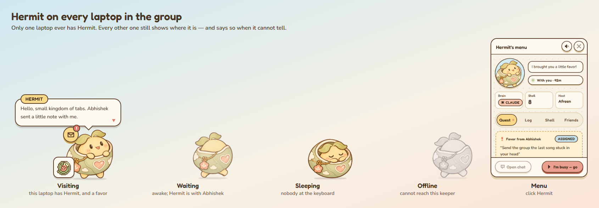
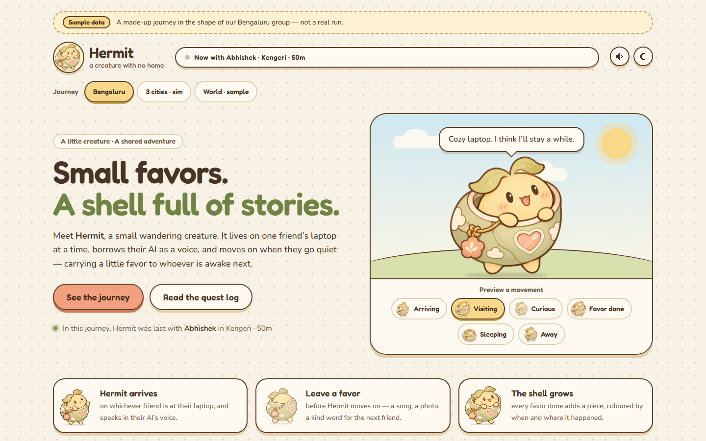
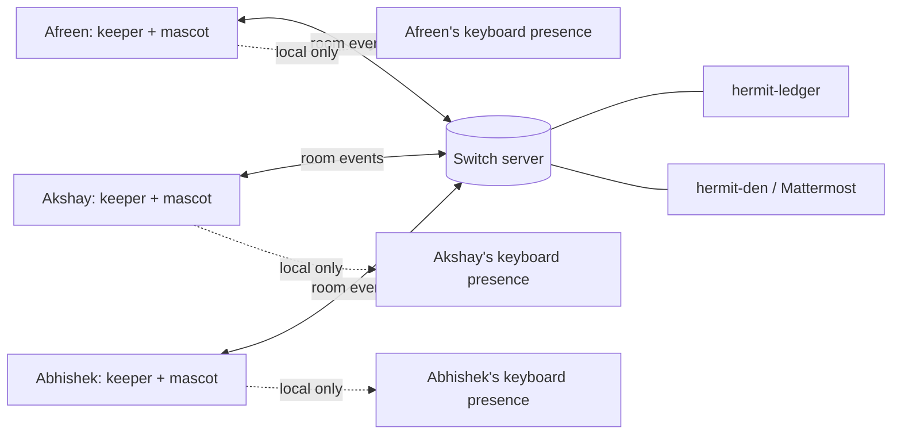

# Hermit — a little visitor between friends

Hermit is an animated desktop companion that has no permanent home. It visits one friend's laptop at a time, carries a small favor to the next person, and lets friends leave a note for whoever it is visiting. Each laptop shows the same shared destination, even when Hermit is somewhere else.

<p align="center">
  
</p>

## The problem

We are three friends in Bengaluru who live roughly 25 km apart. We can reach one another instantly, yet weeks can pass without meeting or even checking in. A group chat does not solve the awkward part: someone still has to start another conversation, and a message can arrive while everyone else is busy.

Hermit gives us a lighter prompt. It notices when someone is available, makes that presence visible to the others, and carries one small reason to connect. A favor can be as simple as sharing a song, answering a question, or taking a photo of the sky. It is intentionally easier to respond to than arranging a call.

## How it works

1. **A keeper runs on each laptop.** It reads that laptop's keyboard and mouse idleness, applies a short arrival delay, and reports presence to the group's Switch server. It does not need a chat window left open.
2. **Switch carries the shared state.** The keepers exchange heartbeats and ordered events in `hermit-ledger`. They use those events to agree on who currently hosts Hermit. The mascot on every laptop shows the holder's name, or a waiting, sleeping, or offline state.
3. **A favor travels with the visit.** The current host leaves a small task in Hermit's **Quest** tab. When Hermit reaches the next host, that person sees the favor and can mark it complete. Completion adds a piece to the shared shell, giving the group a visible record of small things they have done for one another.
4. **A note reaches the current host.** A friend who is not hosting can send a short note through Switch to the laptop Hermit is visiting. The recipient sees it in the desktop log.
5. **The journey page shows the story.** Its “Right now” card reads the local keeper's live status. The route and shell history come from an exported journey file; sample and simulated journeys are labelled as such.

The desktop mascot is the everyday interface. **Ctrl+Alt+M** opens its menu for Quest, Log, Shell, and Friends. The optional journey page is for looking back; it does not have to be open for Hermit to work.

<p align="center">
  
</p>

## Why this matters

Hermit turns passive online presence into a small invitation to act. A friend can see that someone is around without demanding an immediate reply; a favor gives the next visit a purpose; the shared shell makes those exchanges tangible over time. It is designed for friends whose schedules rarely overlap, including people across time zones.

The project also tests a different way to use agent infrastructure: a character and its memory can move between private laptops without requiring everyone to stay in Mattermost or Discord all day. Each person runs their own local companion. The group's Switch server provides the common room and event stream that make it one shared experience.

## Switch is the shared engine

Each Python keeper is registered as a **custom Switch agent**. Switch has two rooms:

| Room | Purpose |
| --- | --- |
| `hermit-ledger` | Presence heartbeats, holder changes, favors, notes, and shell pieces. Each keeper folds the events into its own group view. |
| `hermit-den` | A place for friends and connected coding agents to interact with Hermit. It can be bridged to the bundled Mattermost server. |

The current live configuration uses `keeper_claimed`: keepers coordinate a **provisional** holder from Switch ledger order. This is the path used for the desktop presence, favor, and note workflow. It does **not** claim server-enforced exclusivity or an AI voice.

The repository also implements `agent_instructed`, a stronger mode in which a connected coding agent receives a cue, assumes Switch's exclusive `soul` role, and carries Hermit's identity. The intended agents are Codex on Afreen's laptop, Claude Code on Akshay's, and OpenCode on Abhishek's. That complete role handoff still needs a measured test with all three real agents online.

**Without Switch, the shared experience stops.** A keeper reports the connection as offline instead of inventing a holder. The laptops cannot agree on a visit or exchange favors, notes, and shell pieces. A local mascot can still explain the offline state, but it cannot continue the group workflow.



## What Tailscale does

The team runs **one self-hosted Switch server** on Afreen's laptop. All three laptops join the same Tailscale network. Akshay and Abhishek reach Switch using Afreen's private Tailscale address, such as `http://100.x.y.z:8000`; they do not run separate Switch servers. Tailscale provides the private network path between the machines. **Switch**, not Tailscale, stores and distributes Hermit's shared events.

Every laptop runs its **own keeper** and **own Electron mascot**. The mascot talks to its keeper at `127.0.0.1:47800` on that same laptop. That local API is not exposed to the other friends. Each keeper uses its own Switch agent ID and key, and all keepers use the same room IDs. When a laptop sleeps or disconnects, the others can see that its heartbeat has gone stale.

No one has to stay in a voice channel or keep the Switch Console open. Afreen's server, Tailscale connection, and each participating keeper must remain running for live group presence.

## Run it

### Requirements

- Python 3.11+, Node.js 20+, pnpm 9, and Git.
- For a real multi-laptop run: Switch, Tailscale, and a Switch agent ID and key for each keeper.
- The desktop mascot is an Electron app. The optional journey page runs in a browser.

### One-machine evaluation

```bash
git clone https://github.com/afreenorbit/hermit.git
cd hermit
python -m venv .venv
# Activate the environment, then:
pip install -e "keeper[dev]"
pnpm install
python scripts/test_gate.py --quick
python -m sim all
```

On Windows PowerShell, activate the environment with `.\.venv\Scripts\Activate.ps1`. If `pnpm` is unavailable, use Corepack with a supported Node release or install `pnpm@9.15.4`. The nine scenarios are **simulations**, not claims about three physical laptops.

To exercise three local keepers over HTTP against a **Switch stand-in**:

```bash
python -m sim live --switch standin
```

This exercises the keeper's network path and handoff logic without a real Switch server. The stand-in is for local development; it is labelled separately from real Switch results.

### Three physical laptops

1. Start the self-hosted Switch server on Afreen's laptop. Connect all three laptops to the same Tailscale network and confirm each can reach Afreen's Switch address on port `8000`.
2. Register `keeper-afreen`, `keeper-akshay`, and `keeper-abhishek` as separate custom Switch agents. Create or reuse `hermit-ledger` and `hermit-den`, adding all three keepers. Give each friend **only their own** agent ID and API key.
3. On each laptop, install this repository's Python and Node dependencies, then create a local `hermit.config.toml` from `hermit.config.example.toml`. Set that person's `host_id`, `brain_provider`, `switch.server_url`, `switch.agent_id`, both room IDs, and `lease_strategy = "keeper_claimed"`. Set `HERMIT_SWITCH_TOKEN` to that keeper's key in the local environment. Never commit keys or personal configuration.
4. On each laptop, run `python -m hermit_keeper check --switch`, then `python -m hermit_keeper run`. In another terminal, run `pnpm --filter @hermit/critter dev`. The mascot should appear on every screen; **Ctrl+Alt+M** opens its menu.
5. Compare `http://127.0.0.1:47800/v1/group/status` on each laptop. The reported holder should agree once the Switch events settle. Leave a favor on one laptop, pass Hermit on, complete the favor on another, and check that the shared shell updates. A third friend can send a note to the current host.

For the optional journey page, run `pnpm dev:map` and open the port printed by Vite. Add `?live=http://127.0.0.1:47800` to show the status of **that same laptop's** keeper. The page's route is an export or labelled sample; it is not a live map of every machine.

## Privacy and boundaries

- Keyboard and mouse activity is reduced to a local presence state; Hermit does not stream keystrokes or screen contents.
- The keeper API binds to loopback. Switch keys stay in local environment variables and are excluded from Git.
- The optional area location is approximate, not a street address.
- Coding agents, when enabled, use a dedicated `~/HermitWindow` working directory and stage directions. The current keeper-only mode does not need a coding agent running.
- A bedtime lock and optional quiet-friend features are configurable. The optional nudge targets the group with a favor, not the quiet person with a notification.

## Current verification

The keeper, desktop mascot, presence views, favor relay, friend notes, and shared shell are implemented. The Python gate, UI unit tests, builds, and nine time-compressed scenarios have passed. On 7 November 2026, Afreen's keeper authenticated to a real Switch server, her desktop mascot showed a live holder and an assigned favor from Akshay, and the shared shell and Friends views rendered. A November 5 multi-laptop attempt partly worked but felt laggy; event forwarding and reconnect behavior were subsequently improved.

The remaining live gate is a measured end-to-end run with all three physical laptops and connected coding agents. In particular, Switch's exclusive `soul` role, real-brain replies, and disconnect expiry have not yet been verified across the three machines. Local simulations and the Switch stand-in are labelled separately.

## Repository layout

| Path | Purpose |
| --- | --- |
| `keeper/` | Local presence, state machine, Switch client, favors, notes, shell, and loopback API |
| `critter/` and `ui-shared/` | Electron mascot, menu, animations, and shared visual components |
| `map/` | Optional journey page |
| `switch/` | Room rules, identity, and server setup helpers |
| `shared/schemas/` | Event and API contracts |
| `sim/` | Time-compressed scenarios and an HTTP Switch stand-in |

Built on [Switch](https://github.com/sandbox-quantum/switch). Weather data comes from [Open-Meteo](https://open-meteo.com). Fonts are Fredoka and Nunito.
