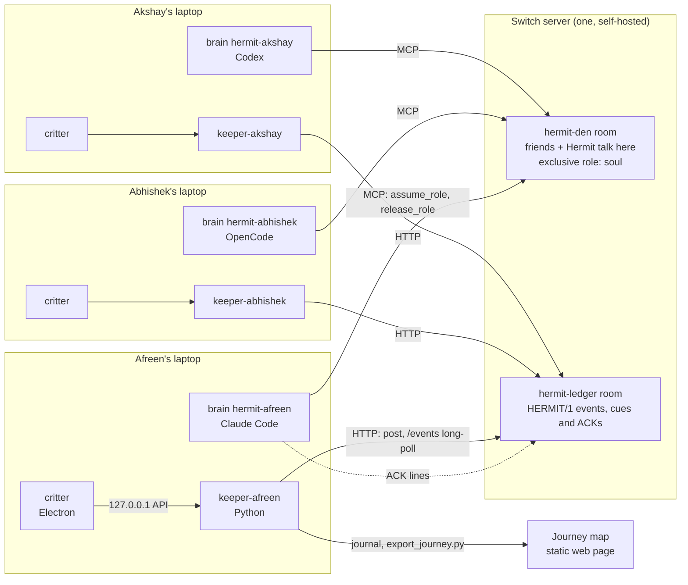
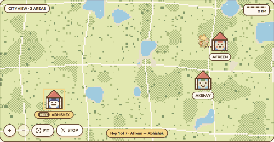
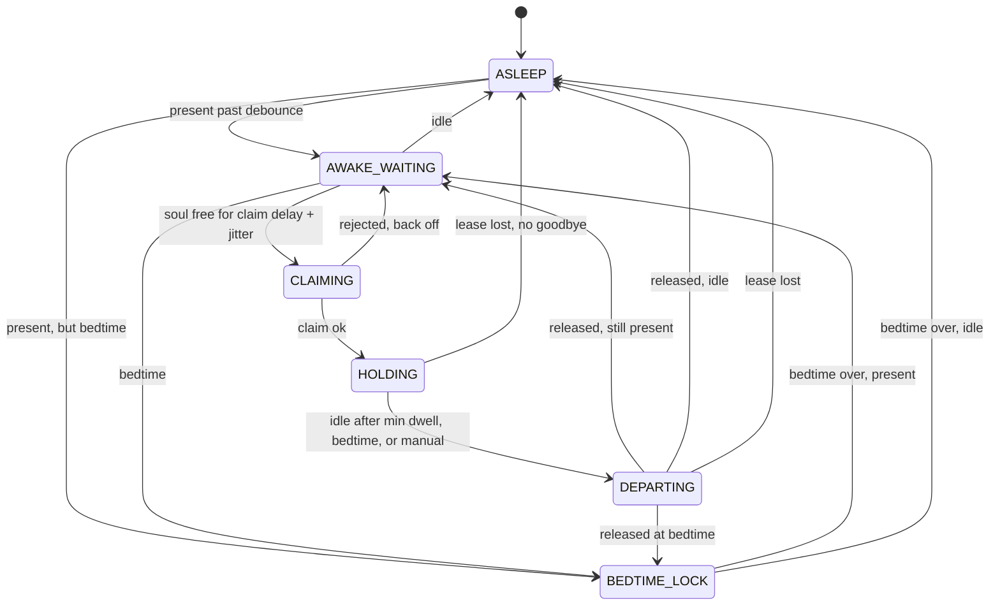

<h1 align="center">Hermit</h1>

<p align="center">
  <strong>A small creature with no home of its own.</strong><br>
  It lives on one friend's laptop at a time and uses that friend's own AI agent as its brain.<br>
  When they go quiet, it moves to whoever is still around and brings a favor from the last friend.
</p>

<p align="center">
  <a href="https://github.com/afreenorbit/hermit/actions/workflows/ci.yml"></a>
  ·
  Built for <a href="https://www.wemakedevs.org/hackathons/switch">Flip the Switch</a>
  (WeMakeDevs × DevTools Academy × Switch) · <strong>Track 02: Best Personal or Creative Workflow</strong>
</p>

<p align="center">
  
</p>

<p align="center">
  
</p>

> **Status, in one line:** the code is built and tested, and its Switch client has talked to a real
> `switch-v0.9.0` server. The full handoff has run over real HTTP against a **stand-in** Switch
> server, but **not yet on three real laptops with real brains**. See [Status](#status) for exactly
> what is proven and what is still open.

---

## The problem

- Distance is the top reason friendships fade: 50% of respondents named it in a 2025 Talker Research poll of 2,000 Americans.
- Young adults often have plenty of friends but lack **continuity and routine** (Hall et al., *PLOS ONE*, Nov 2025).
- Async tools such as Marco Polo, Waffle, Cave and Locket still need someone to start every exchange. Group chats die because nobody starts them.

We are three friends in Bengaluru, about 25 km apart, who still go weeks without seeing each other.
Hermit **creates the recurring moment itself**. It follows *attention*, not daylight: the soul goes
to whoever is actually at their laptop, which in one city means someone is always free.

## How Switch makes Hermit possible

*Judging: Use of Switch (30%)*

Every laptop runs **two Switch agents**:

- **The brain**, `hermit-<you>`, is the friend's own off-the-shelf coding agent (Claude Code, OpenCode
  or Codex), onboarded in Switch Console with its working directory set to `~/HermitWindow`.
- **The keeper**, `keeper-<you>`, is our Python process. It is registered as a custom agent with
  `POST /agents` and handles presence, the state machine, the ledger and the local API that the
  critter reads.



**The soul is held by the brain, not by our code.** Switch has no path for one agent to assume a
role for another, and it has no HTTP endpoint for roles. So the keeper posts a cue in the ledger, the
brain calls `assume_role("soul")` itself and ACKs, and every keeper **observes** the result by folding
the ledger ([`lease/soul_ledger.py`](keeper/hermit_keeper/lease/soul_ledger.py)). Switch enforces
exclusivity. The keepers only mirror it. Full sequence: [`docs/architecture.md`](docs/architecture.md).

| Switch feature | Hermit mechanic | Where it stands |
|---|---|---|
| **Exclusive role** (`define_role(..., exclusive=True)`) | **The soul.** Whichever brain holds it *is* Hermit. A second `assume_role` fails, so there can never be two Hermits. | Read in Switch source ([SP1](docs/switch-facts.md)). Not yet run with real brains (setup D5). |
| **Role instructions** (returned by `assume_role`) | **Hermit's identity arrives as the role's instructions.** [`hermit-identity.md`](switch/rules/hermit-identity.md) is the `soul` role's text, so the personality lives in Switch and travels with the soul. | Read in source (SP2). Not yet observed live. |
| **Session-bound lease** (auto-releases after the holder disconnects) | **Lid slam.** No goodbye is needed. The soul frees itself, the next friend claims it, and the stop is recorded `abrupt` with a cracked shell piece. | Read in source (SP3). Expiry time **not measured**: `lease_expiry_s = 8` is a guess. |
| **Rooms + agent HTTP API** (`POST /agents/{id}/message`, `GET /agents/{id}/events`) | **The ledger is the group's only shared memory.** Holder, group view, favors and the journey are all folds over `hermit-ledger`. | **Verified on real `switch-v0.9.0`**: one keeper posted a ledger line and another received it. |
| **`@soul` addressing and `!roles`** | Friends talk to **Hermit**, not to a laptop. `@soul hi` is answered by whichever brain holds the soul, and `!roles` shows who that is. | In the setup runbook (D4–D6). Not yet run. |
| **Custom agents beside coding agents** | Our keeper (`connector_type: custom`) sits in the same rooms as Claude Code, OpenCode and Codex. | Keeper registration verified live. |
| **Agent working directory** (Switch Console) | Each brain is scoped to `~/HermitWindow`, so Switch enforces the privacy promise. | Setup step B3. |
| **Room instructions** | House rules: bedtime, consent ("mute"), privacy, one soul ([`hermit-house-rules.md`](switch/rules/hermit-house-rules.md)). | Pasted in Console (setup C1). |
| **Self-hosted, bring your own agent** | No central server of ours and no AI bill. Messages stay on the group's server. | By design. |

**Favors are not Switch Tasks.** A Task needs a performer agent when it is created, and a favor is
left for *whoever Hermit visits next*. That person is unknown when the favor is written. So a favor is
**ledger lines** (`FAVOR_LEFT` → `FAVOR_ASSIGNED` → `FAVOR_COMPLETED`) plus **den messages** from the
brain. Reasoning: [switch-facts SP5](docs/switch-facts.md).

### What breaks without Switch

- **No exclusive role, no "one Hermit".** The keepers can only *observe* the holder. Without Switch
  refusing the second `assume_role`, nothing stops two laptops from both being Hermit.
- **No role instructions, no portable identity.** Hermit would be a prompt in our code. With them,
  the room hands the personality to whichever brain earns the soul.
- **No session lease, no lid-slam handoff.** A dead laptop would hold the soul forever.
- **No shared rooms, no shared memory.** Three laptops on three networks would have nothing in common.
  The ledger is the group's memory, and the den is where friends meet Hermit.

The offline `lease_strategy = "fake"` exists for UI work and the simulation, and everything it
produces is labelled SIMULATION.

## Quickstart for judges: one machine, about 10 minutes

*Judging: Technical execution (25%)*

You need **Python 3.11+**, **Node 20+** with pnpm 9, and git. Docker and Switch are **not** needed for
this.

**1. Install**

```bash
git clone https://github.com/afreenorbit/hermit.git && cd hermit
```

```bash
python3 -m venv .venv && source .venv/bin/activate && pip install -e "keeper[dev]"
```

Windows PowerShell (use `;`, not `&&`):

```powershell
py -m venv .venv; .\.venv\Scripts\Activate.ps1; pip install -e "keeper[dev]"
```

**2. Test gate** (ruff, ruff format, strict mypy, keeper tests and every sim scenario)

```bash
python scripts/test_gate.py --quick
```

Expected, ending with:

```text
GATE PASSED
  ok  ruff check         0.2s
  ok  ruff format        0.1s
  ok  mypy (strict)      5.5s
  ok  keeper tests      93.8s
  ok  sim scenarios      2.5s
```

**3. Every scenario, time-compressed (SIMULATION)**

```bash
python -m sim all
```

Nine scenarios, each ending in `PASS`. For example:

```text
=== lid_slam ===
  00:31  Hermit is with afreen
  01:00  afreen slammed the lid
  01:00  Hermit is between friends
  01:01  Hermit is with abhishek
  01:01  "I left in a hurry" - abhishek gets a cracked shell piece
  PASS  2 stops, 1 shell pieces -> sim/out/lid_slam/journey.json
```

**4. The real keeper code path over HTTP, against a Switch STAND-IN**

```bash
python -m sim live --switch standin
```

This starts three keepers built by the same function that `hermit-keeper run` uses, plus three
stand-in brains that follow the stage directions. They all talk over loopback HTTP to
[`sim/switch_standin.py`](sim/switch_standin.py), which is **a stand-in for Switch, not Switch**. In a
second terminal:

```bash
curl -s http://127.0.0.1:47801/v1/status    # afreen   (47802 abhishek, 47803 akshay)
```

```text
{"host":"afreen","state":"HOLDING","present":true,"soul_holder":"afreen","since":"…","mood":"arriving","favor_pending":null,"last_line":null,"switch":"online"}
```

The other two ports report `"state":"AWAKE_WAITING"`, `"soul_holder":"afreen"` and `"mood":"waiting"`.
Which host wins the first claim varies. Now break things:

```bash
curl -s -X POST http://127.0.0.1:47804/lid-slam/afreen   # slam the holder's lid (use whoever holds it)
curl -s http://127.0.0.1:47804/                          # who holds what, according to the stand-in
curl -s -X POST http://127.0.0.1:47804/switch/down       # Switch outage: every keeper says "switch":"offline", "soul_holder":null
curl -s -X POST http://127.0.0.1:47804/switch/up         # recovers, same holder
```

What we saw: within 10 s of the lid slam (the stand-in's lease expiry is 3 s), the stand-in reported `"role_holders_in_standin":["hermit-akshay"]`
and both other keepers agreed. During the outage nobody was `visiting`. After `/switch/up`
everyone reported `"switch":"online"` again with the same holder. To force a normal idle handoff:

```bash
curl -s -X POST http://127.0.0.1:47803/v1/presence/override -H "content-type: application/json" -d '{"mode":"asleep"}'
```

**5. The journey map**

```bash
corepack enable pnpm && pnpm install    # Node 25 dropped corepack: use npm i -g pnpm@9.15.4
pnpm dev:map
```

Open `http://localhost:5173/?journey=three_cities`. Use the port Vite prints, because it is not always
5173. This is the `three_cities_day` scenario, Bengaluru → Berlin → Toronto, and the page stamps it
**SIMULATION**. Add `?live=http://127.0.0.1:47801` while step 4 is running to get the live "Right now"
panel.

<p align="center">
  
</p>

**6. Numbers (SIMULATION)**

```bash
python -m sim metrics
```

This prints the table in [`docs/metrics.md`](docs/metrics.md). Every row is labelled **SIMULATION**.
The simulated handoff latency (pooled p50 1m00s, p95 1m30s) **counts 30-second sim ticks**, because the
fake lease frees instantly. It is not a measurement of Switch.

## Three real laptops

The runbook is [`docs/switch-setup.md`](docs/switch-setup.md). It covers one Switch server on Afreen's
laptop over Tailscale, Switch Console on every laptop, onboarding each brain with
`~/HermitWindow`, creating the rooms and the `soul` role, and the D1–D8 gates. Run the test itself with
[`docs/actual-test.md`](docs/actual-test.md) and [`docs/live-test.md`](docs/live-test.md).

| Host | `host_id` | Brain | Fallback |
|---|---|---|---|
| Afreen | `afreen` | Claude Code | OpenCode, Codex |
| Abhishek | `abhishek` | OpenCode | Claude Code |
| Akshay | `akshay` | Codex | Claude Code |

Every brain is different on purpose: the room memory has to survive the agent changing underneath it.
If a brain will not join a room, that host falls back to Claude Code and we will say so here.

## Engineering

**The state machine** ([`statemachine.py`](keeper/hermit_keeper/statemachine.py)), driven by `tick()`
so a simulated day runs in milliseconds:



When the lease is lost, the machine lands in `AWAKE_WAITING` instead of `ASLEEP` if the host is still
present. `BEDTIME_LOCK` never claims, however awake the host is.

**The one-soul invariant: at most one host in `HOLDING`, ever.**

- Hypothesis property tests:
  [`test_statemachine_properties.py`](keeper/tests/unit/test_statemachine_properties.py) runs random
  presence timelines for three hosts over two simulated hours and asserts at most one holder after
  every single tick. [`test_soul_invariant.py`](keeper/tests/unit/test_soul_invariant.py) runs
  arbitrary claim, release and expire interleavings.
- Stand-in races: [`test_switch_standin.py`](keeper/tests/integration/test_switch_standin.py) runs ten
  three-way claim races, with and without own-message echo, against the stand-in over real HTTP.
  A watchdog samples throughout and must record zero breaches. The same file covers idle handoff,
  lid slam (recorded `abrupt`), Switch outage and recovery, a favor crossing laptops, and brains that
  lie about claiming.

**Test counts, observed on this branch** (Windows, Python 3.14):

| Suite | Result |
|---|---|
| Keeper (`pytest -m "not live"`) | 257 passed, 1 skipped (a symlink test that needs extra privileges on Windows), 2 live tests deselected |
| Sim (`python -m sim all`) | 9 / 9 scenarios PASS |
| UI (`pnpm -r test`, Vitest) | 94 passed: ui-shared 52, map 33, critter 9 |
| Map e2e (Playwright) | runs in CI |
| Live (`pytest -m live`) | needs a real Switch server; not part of the gate |

CI runs ruff, `ruff format --check`, strict mypy, the keeper tests, every sim scenario, UI typecheck and
tests, and the map e2e on every PR.

## Status

**Verified against a real Switch (`switch-v0.9.0`, local, one machine)**

- Keeper agent registration (`POST /agents`, Bearer auth, `connector_type: custom`).
- One registered keeper posted a ledger line to a real room, and another received it through
  `GET /agents/{id}/events`.
- There is no roles endpoint and no documents endpoint over HTTP. That is why the holder is folded
  from the ledger. Details: [`docs/switch-facts.md`](docs/switch-facts.md).

**Proven over real HTTP against a STAND-IN, not against real Switch**

- Three keepers, built exactly as `hermit-keeper run` builds them, plus stand-in brains, against
  [`sim/switch_standin.py`](sim/switch_standin.py). This covered one holder across 10 three-way races,
  idle handoff, lid slam → expiry → abrupt departure, outage → `offline` → recovery, a favor crossing
  laptops, and lying brains still converging. It proves our code behaves correctly *if* Switch and
  the brains behave as documented.

**Not verified yet**

- [ ] **Nothing has run on three real laptops yet.**
- [ ] Real role exclusivity with real MCP-connected brains (two brains race `assume_role("soul")`, and Switch refuses the second).
- [ ] Measured lease expiry after a disconnect. `lease_expiry_s = 8` is a guess.
- [ ] Real brains following the stage directions, and memory carrying across Claude Code, OpenCode and Codex.
- [ ] `@soul` addressing and `!roles` in the den.
- [ ] Whether `/events` returns an agent's own posts, and whether senders arrive as names or uuids (the client handles both).
- [ ] The Discord bridge. The den runs on the bundled Mattermost in the setup runbook.
- [ ] The pilot.

## Pilot results

*Judging: Creativity & impact (25%)*

> **Not run yet.** No pilot numbers exist. When the pilot runs, results go in
> [`docs/pilot-results.md`](docs/pilot-results.md), following
> [`docs/pilot-protocol.md`](docs/pilot-protocol.md), and this section links them. Simulated numbers
> never appear here.

## Demo video

*Judging: Presentation (20%)*

> **Video: link to be added.** Shot list: [`docs/demo-script.md`](docs/demo-script.md). Any simulated
> shot is watermarked SIMULATION.

## Privacy and safety

- **One folder.** The brain's working directory is `~/HermitWindow`, set in Switch Console, so Switch
  scopes what the brain can see. The keeper sends only the **number** of files in that folder
  (`window_file_count`), never their names and never their contents, because cues are ledger lines the
  whole group can read.
- **Area-level location.** Each friend types an area centre (e.g. Indiranagar) into their own
  git-ignored config. It is never a street or an address, there is no tracking, and the coordinates
  never leave the group's own Switch server.
- **The bedtime rule.** Past your bedtime, Hermit leaves, teases you gently and stays away until
  morning (`BEDTIME_LOCK` never claims). It never rewards staying up.
- **Opt-in extras.** The overlap finder and the quiet-friend nudge are off by default
  (`[features] overlap = false, nudge = false`). The nudge asks the *group* to leave a favor for a
  quiet friend. It never pings that friend.
- **Consent.** The den's house rules tell Hermit to stop when anyone says "mute". The brain follows
  this as a room rule, and the keeper does not enforce it. Keys live in environment variables, never
  in config files or git.
- **No server of ours.** The only server is the Switch server the group runs.

## Team

| | Role |
|---|---|
| **Afreen** | Switch and core: Switch integration, keeper, lease, state machine |
| **Abhishek** | Gameplay and data: favors, shell, bedtime, journal, metrics, pilot |
| **Akshay** | UI and story: critter, journey map, design, demo |

## Credits and license

- Built on [Switch](https://github.com/sandbox-quantum/switch), which is Apache 2.0 + Commons Clause.
  We build on it, and we do not sell it.
- Weather from [Open-Meteo](https://open-meteo.com) (free, no key). World land mask from the
  public-domain GLOBE dataset via `global-land-mask`. Fonts: Fredoka and Nunito (Google Fonts).
- [`plan.md`](plan.md) is the original build plan. Where it disagrees with
  [`docs/switch-facts.md`](docs/switch-facts.md) (for example favors as Tasks, or a gateway lease),
  switch-facts is right.

**License: to be decided by the team before submission.**

<details>
<summary>Repo layout and contributor commands</summary>

| Path | What's in it |
|---|---|
| `shared/schemas/` | The contracts (events, ledger lines, favors, shell pieces, journey, keeper API) |
| `switch/` | Room rules, the `soul` role's identity, stage directions, `bootstrap_rooms.py` |
| `keeper/` | The Python keeper: presence, lease, state machine, handoff, gameplay, local API |
| `sim/` | Scenarios, the live harness and the Switch stand-in |
| `ui-shared/`, `critter/`, `map/` | Shared UI kit, Electron desktop critter, journey map |
| `docs/` | Switch findings, architecture, runbooks, metrics, pilot, demo script |

| Command | What it does |
|---|---|
| `python scripts/test_gate.py` | The full gate, including UI typecheck and tests |
| `python -m sim live` | Three keepers sharing one fake lease, on ports 47801–47803 |
| `python -m hermit_keeper check` / `check --switch` | Check this laptop's config, then probe its Switch connection |
| `pnpm --filter @hermit/critter dev` | The desktop critter |
| `python scripts/export_journey.py --from-files a.jsonl b.jsonl c.jsonl` | Build `journey.json` from every keeper's journal |

Branches: `feat/…`, `fix/…`, `docs/…`. Commits: conventional. The PR template asks which files are
AI-generated. Answer it honestly.

</details>
