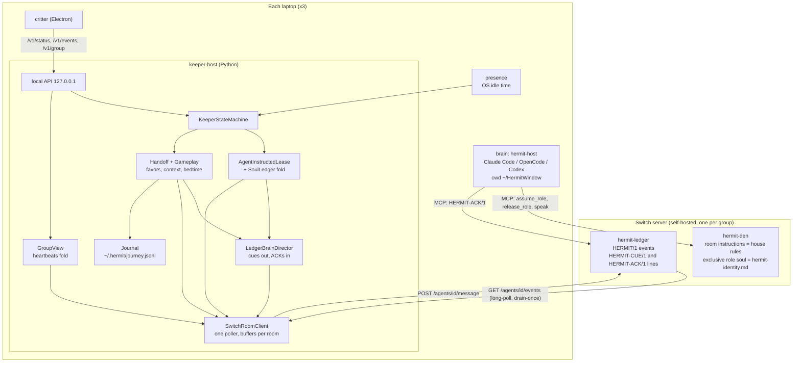
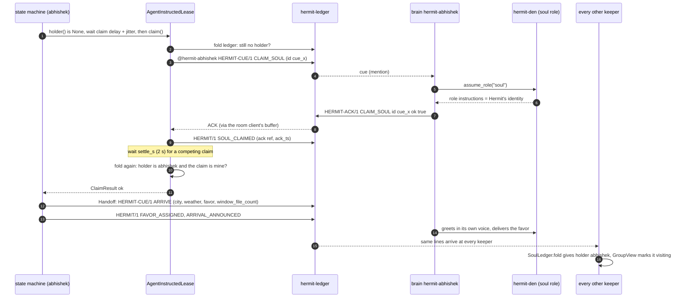
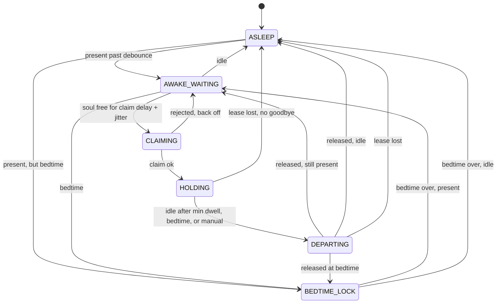
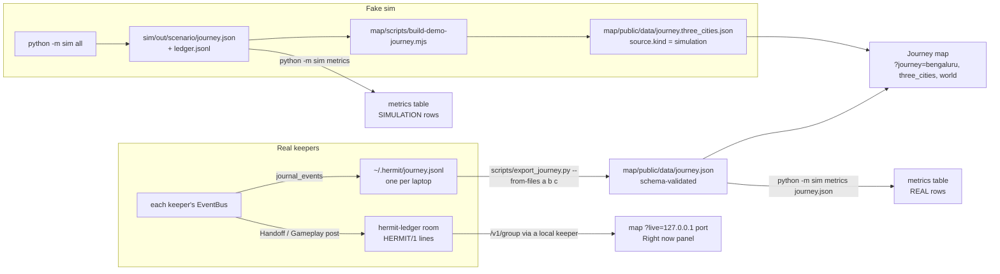

# Architecture

Owner: Afreen (Switch & core). Every diagram here is drawn from the code on
`feat/gameplay-live`. File links point at the code that implements each part.
Where `plan.md` §3 disagrees, this file and [`switch-facts.md`](switch-facts.md)
are right.

**Verification status.** The Switch HTTP calls (register, post, `/events`) are
verified against a real `switch-v0.9.0`. The full sequence below has run over
real HTTP against [`sim/switch_standin.py`](../sim/switch_standin.py), a
**stand-in** for Switch. It has **not** run with real MCP-connected brains or on
three real laptops yet.

## 1. System

- **Two agents per laptop.** The brain is the friend's own coding agent,
  onboarded in Switch Console. The keeper is registered with `POST /agents` as a
  `custom` connector. Only the brain can hold the soul, because `assume_role`
  is only reachable over MCP by the agent itself (switch-facts SP2 and
  "Verified against a running server").
- **One poll per keeper.** `/agents/{id}/events` drains what it hands out, so
  [`SwitchRoomClient`](../keeper/hermit_keeper/room/switch_client.py) owns the
  only poll and everyone else reads its buffer through `history()`. The poller
  is also the connectivity probe: a failure marks the client `offline` and
  resets `listening_since`.
- **Wiring.** [`switch_wiring.build_switch_keeper`](../keeper/hermit_keeper/switch_wiring.py)
  assembles this for `lease_strategy = "agent_instructed"`. The stand-in tests
  call the same function. It never falls back to the fake. Missing
  `agent_id`, room uuids or `HERMIT_SWITCH_TOKEN` stop startup.

## 2. The handoff sequence

Hermit lands on Abhishek's laptop. Keeper names are shortened.

The rules that make this safe:

- **An ACK alone never makes a keeper Hermit.** `claim()` succeeds only when
  the brain said `ok:true` **and** the ledger fold still names this claim after
  the settle window. Otherwise it concedes: it cues `RELEASE_SOUL` and writes
  `SOUL_RELEASED {releases: ref}`.
- **Order comes from the brain's ACK**, by server timestamp and message id.
  ACKs are posted by brains, so no laptop's clock can reorder claims.
- **Two live claims, no release between them**: the earlier claim wins, unless
  its host had been silent for more than `2 × heartbeat + lease_expiry_s` when
  the later one was made. The loser's keeper cues its brain to let go
  ([`soul_ledger.py`](../keeper/hermit_keeper/lease/soul_ledger.py)).
- **Departure.** `Handoff.on_departing` cues `ASK_FAVOR` and waits up to 90 s,
  capped at 60 s on the real path, for the host's next den message. Then it
  writes `FAVOR_LEFT`, cues `DEPART` and writes `SOUL_RELEASED`. The lease then
  cues `RELEASE_SOUL`, and the brain calls `release_role()`.
- **Lid slam.** No keeper code runs. Switch drops the lease when the brain's
  session dies (SP3). Other keepers see the holder's heartbeats stop and treat
  the soul as free after `2 × heartbeat + lease_expiry_s`. The next arrival
  finds an `ARRIVAL_ANNOUNCED` with no `SOUL_RELEASED`, records the stop as
  `abrupt`, and adds a cracked shell piece (S3).
- **Switch unreachable.** `holder()` returns the last known holder internally,
  but `/v1/status` and `/v1/group` report `"switch":"offline"` and
  `"soul_holder":null`, and nobody is shown `visiting`. After reconnecting, a
  keeper that held the soul re-cues `CLAIM_SOUL` with `verify: true`.

## 3. State machine

From [`statemachine.py`](../keeper/hermit_keeper/statemachine.py). `tick()` is
called every `TICK_S` (5 s) by [`runtime.py`](../keeper/hermit_keeper/runtime.py).
The heartbeat runs on its own task so that a long tick (waiting for an ACK or a
favor) never looks like a lid slam.

- **Lease lost beats everything.** In `HOLDING` or `DEPARTING`, if
  `lease.holder()` is not this agent, the machine stops being Hermit at once
  and emits `SOUL_FREE {freed_by: lease_expiry}`. It lands in `AWAKE_WAITING`
  instead of `ASLEEP` if the host is still present.
- **Min dwell** (`min_dwell_s`, 600 s) applies only to voluntary idle
  departures. Bedtime and manual departure skip it, and a lid slam never passes
  through this code.
- **Fairness** comes from `claim_delay_s` plus random `claim_jitter_s`. A
  rejected claim backs off for `backoff_s`.
- **`BEDTIME_LOCK` never claims.**

The **invariant** is that at most one host is in `HOLDING` across the group. It
is enforced by Switch's exclusive role and protected here by never speaking
without the lease. Tests: `test_statemachine_properties.py` and
`test_soul_invariant.py` (Hypothesis), and `test_switch_standin.py` (10
three-way races over HTTP, with and without own-message echo).

### Mood (what the critter shows)

The machine state and the soul holder stay separate everywhere
([`group.py`](../keeper/hermit_keeper/group.py)): **who holds the soul** has one
answer for the group, and **whether a laptop can host** comes from that
laptop's own keyboard. Moods: `visiting`, `arriving` (the first 10 s after a
successful claim), `away`, `sleeping`, `waiting`, and `offline` (no heartbeat for
35 s, or Switch unreachable).

## 4. Data flow: ledger, journey, map, metrics

- **The ledger is the source of truth.** Every keeper folds the same lines into
  the soul holder (`SoulLedger`), the group view (`GroupView`, from
  `HOST_HEARTBEAT`) and the favor book (`LedgerFavors`, from `FAVOR_*`, keyed
  by event id).
- **Favors are not Switch Tasks.** A favor is `FAVOR_LEFT` → `FAVOR_ASSIGNED`
  → `FAVOR_COMPLETED` in the ledger, plus the brain's messages in the den.
  The host's next human message in the den is captured as the favor, and later
  as its completion. Completing a favor writes `SHELL_PIECE_ADDED`.
- **Exporting a real journey.** Each keeper mirrors its own bus events to
  `~/.hermit/journey.jsonl`. To build the group's journey, collect all three
  journals and run `python scripts/export_journey.py --from-files …`.
  `--from-room` is not implemented: the room client cannot page back through
  history, because `/events` is drain-once and room history returned empty on
  v0.9.0.
- **Metrics** ([`metrics.py`](../keeper/hermit_keeper/metrics.py)) carry a
  `source` of `simulation` or `real` and never pool the two. Simulated handoff
  latency counts 30-second sim ticks against a fake lease that frees
  instantly, so it measures nothing about Switch. See [`metrics.md`](metrics.md).
- **Which journey the map shows.** `?journey=bengaluru` (the default) loads
  the git-ignored `data/journey.json` if one was exported, and otherwise falls
  back to the committed, labelled sample. `three_cities` is the simulation, and
  `world` is a hand-made sample. A journey whose `source.kind` is `simulation`
  is stamped SIMULATION on the page.
- **Live view.** The map's `?live=` accepts loopback origins only, so live
  status works on a laptop running a keeper. A published map shows the journey
  only.

## 5. The opt-in extras

[`stretch.py`](../keeper/hermit_keeper/stretch.py) runs S1 (overlap finder,
[`overlap.py`](../keeper/hermit_keeper/overlap.py)) and S2 (quiet-friend nudge,
[`nudge.py`](../keeper/hermit_keeper/nudge.py)) inside the keeper. Both are off
unless `[features] overlap` or `nudge` is set. Only the soul holder acts, and
rate limits are read back from the ledger, so three laptops never repeat the
same suggestion. The nudge asks the group to leave a favor for a quiet friend.
It never messages that friend.
