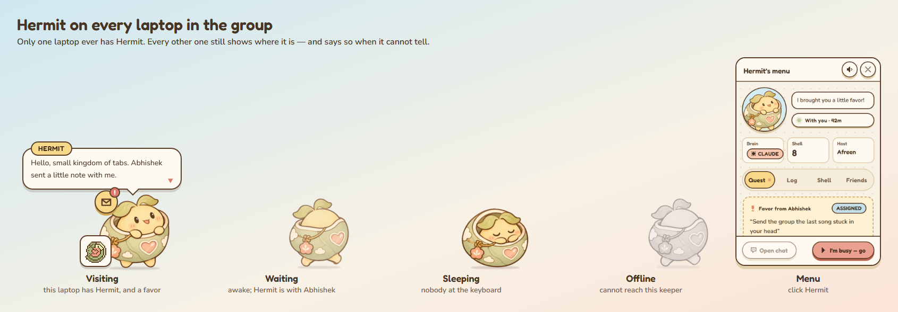
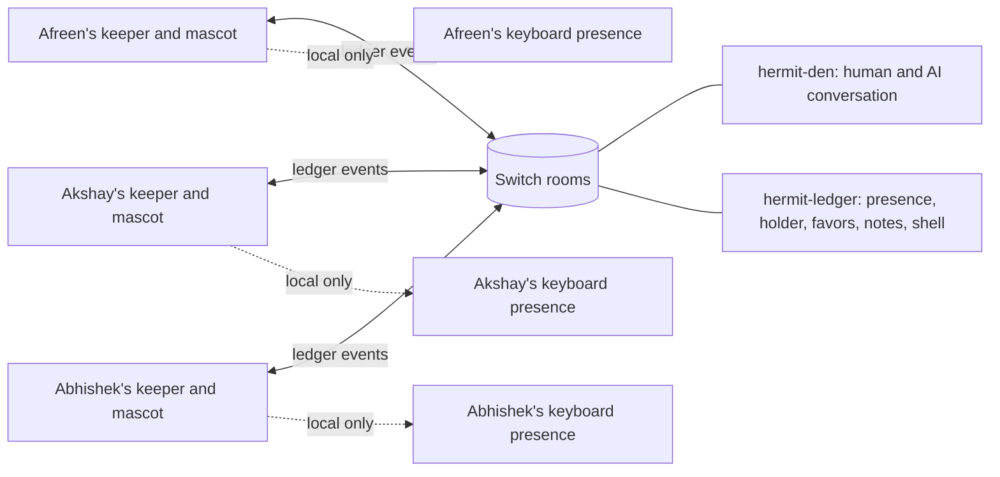
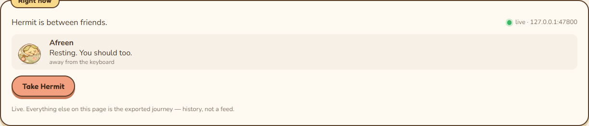
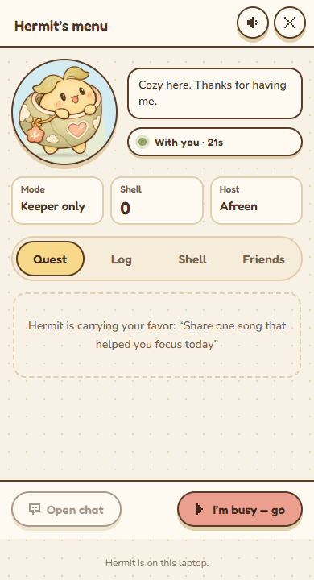
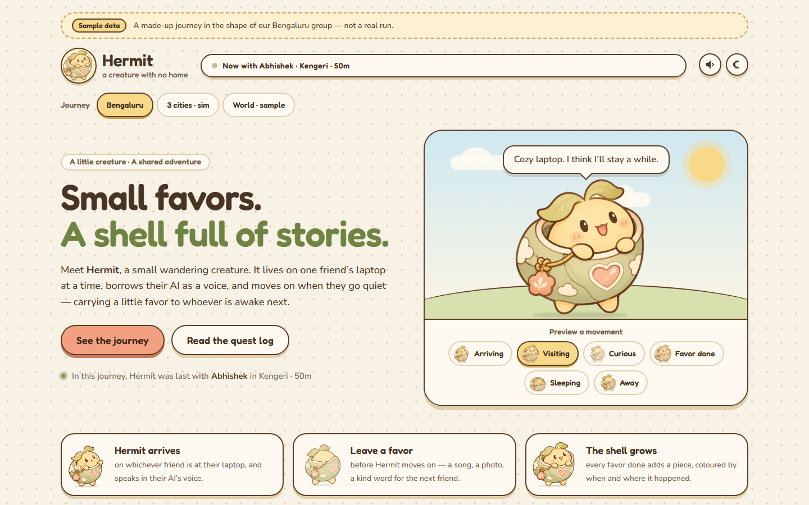

# We built a little creature that carries favors between friends

*Hermit · Flip the Switch, Track 02 · 7 November 2026*

Three friends can be in the same city and still miss each other for weeks. A group chat is available all day, but somebody has to begin every conversation. We wanted a gentler reason to reach out: a tiny visitor that appears when a friend is around, leaves when they are busy, and takes one small thing to the next person.

That is Hermit. It has no permanent laptop. Afreen, Akshay and Abhishek each run a local **keeper** and a desktop mascot. The keeper watches whether its person is at the keyboard, speaks to the team's Switch rooms, and tells the mascot what to show. The current host can leave a favor such as “Share one song that helped you focus.” Hermit carries it to the next host. When that person finishes it, a piece is added to the shared shell. A friend who is not hosting can also send a short note to whoever Hermit is visiting.

*The desktop designs above are sample captures. The real presence capture farther down this article is from Afreen's local keeper on 7 November; it shows one online laptop.*

## What the experience is meant to feel like

1. Afreen is working. Hermit arrives on her screen. The other laptops still show the mascot, but say where it is visiting.
2. Afreen leaves a small favor in the **Quest** tab. The keeper writes `FAVOR_LEFT` to the shared Switch ledger before she sends Hermit on.
3. Akshay becomes the next host. His keeper reads the favor from the ledger, assigns it, and his mascot shows it as a quest.
4. Akshay does the favor and presses **I did it**. `FAVOR_COMPLETED` and `SHELL_PIECE_ADDED` go into the ledger. Each running keeper folds those lines into its view of the shell.
5. While Hermit is with Akshay, Abhishek can send him a note from the **Friends** tab. The recipient is determined from the current holder, and the note goes through Switch. It appears in Akshay's desktop log.

This makes the creature an invitation to do a real, small task together. It can be a check-in, a shared song, a question, a drawing prompt or a photo of the sky. The work is deliberately tiny: a favor should be easier than scheduling a call.

## The system behind the character

The keeper is a custom Switch agent on each laptop. Its own API listens only on `127.0.0.1`; the Electron mascot and optional journey page call that API. The keeper's Switch client has **one** background reader of `/agents/{id}/events`. That endpoint is a draining queue, so a second reader could consume an event before the keeper saw it. The client buffers delivered messages locally; the presence, favor and shell views read that buffer.

Switch is central to the live workflow. If it is unreachable, the keeper reports `switch: offline`, the holder becomes unknown, notes cannot be sent, and the three laptops cannot agree on a favor or shell. The fake lease and the Switch stand-in are explicitly for development and labelled simulation. The local desktop is still visible when offline so a person can tell why the live experience stopped.

There are two holder modes in the repository. The **currently exercised** `keeper_claimed` mode lets the keepers coordinate a provisional holder through Switch ledger events. It does not have server-enforced exclusivity. The intended stronger `agent_instructed` mode gives each friend's coding agent an exclusive Switch `soul` role; the role's instructions carry Hermit's voice between Codex, Claude Code and OpenCode. That role handoff has not yet been proven with the live server. We do not describe the provisional mode as if Switch had enforced the role.

## What we learned from a real Switch server

The first integration did not follow our original plan. On the tested `switch-v0.9.0` server, the keeper could register as a custom agent, post a room message, and receive it as another agent. The room-history endpoint did not return the messages the keeper needed; the agent event queue did. Switch roles and documents did not have the HTTP path the keeper initially expected. We therefore separated the coding agent's intended role actions from the keeper's event work, and used ledger lines for favors whose future recipient is not yet known.

One subtle bug followed from that: timestamp-only polling can miss two events carrying the same timestamp. The keeper now tracks message IDs while folding the recent ledger, so a second note at the same instant is still delivered. A focused test sends two notes without advancing the fake clock and checks that the recipient sees both in order.

The shell also needed a real data path. Its UI existed before the API did: `/v1/shell` returned an empty list, and status always returned `favor_pending: null`. The keeper now serves the assigned favor and reconstructs shell pieces from Switch ledger lines, with a local snapshot to preserve pieces it already observed across its own restart. A fresh laptop cannot recover events that have already fallen out of the server's drain-only queue; a future version should store a durable shared snapshot in Switch. This is a real current limit, especially for a long pilot.

## What is running today

On 7 November, Afreen's local Switch stack answered its health check, her keeper key authenticated to the live server, and the keeper reported `switch: online`. We then made a controlled claim: it moved from `CLAIMING` to `HOLDING`, wrote one real favor to the Switch ledger, and released back to no holder. The first browser capture below is from **Microsoft Edge** pointed at the local Hermit page and the local keeper. Only Afreen was online. The mascot correctly showed a resting state when no one held it.

*Live local status, 7 November 2026. This is one laptop and one real Switch connection, not evidence of a three-laptop handoff. The journey elsewhere on the map is a separate sample export.*

*Live browser preview of the desktop menu while Afreen held Hermit. “Keeper only” makes the current provisional mode explicit. The favor is real Switch ledger data, but no second laptop has received or completed it yet.*

The journey page is an optional memory of where Hermit has been. It reads an exported JSON file; its route, shell and postcard are **history**, while the “Right now” card reads the live local keeper. Keeping those feeds separate prevents a sample route from looking like current presence.

*The journey image uses committed sample data. It is not a live pilot result.*

## Reproduce the behavior

For a code review on one machine, clone the repository, install Python 3.11+ and Node 20+ with pnpm 9, then follow the [README quickstart](../README.md#quickstart-for-judges-one-machine-about-10-minutes). `python scripts/test_gate.py --quick` runs Python quality checks, keeper tests and nine compressed scenarios. `python -m sim live --switch standin` launches three local keepers against a **stand-in** server so the handoff and outage behavior can be watched without three laptops. The journey page has a visible sample or simulation label.

For a real team run, follow [Switch setup](switch-setup.md) and [the live test runbook](running-on-three-laptops.md). Each friend needs Tailscale, their own keeper credentials, the same room IDs, the keeper process, and the desktop mascot. Afreen hosts the Switch stack. The keys belong in local environment variables, never in the repository or the blog. The test is: one host leaves a favor, hands Hermit on, another host completes it, a third sends a note, and all running screens agree on the holder and shell. The coding agents' role test is a separate gate until the exclusive role is verified.

The browser capture above can be reproduced with `node scripts/capture-live.mjs <map-url> <local-keeper-url> <output.png>` from the `map/` directory. It launches headless Microsoft Edge and captures only the Hermit page's live card. It never photographs the ChatGPT window.

## Tests and evidence

- The full keeper gate passed **266 tests, with one existing skip and two live tests deselected**, plus all nine simulations. The explicit cross-laptop test gives two keepers separate books and makes them share only a fake Switch room hub. It checks favor creation, assignment, completion and shell growth.
- A separate note test checks delivery to the current holder and two same-timestamp messages. These are automated tests, not observations of three physical laptops.
- Python strict typing and formatting checks passed. The Electron and map TypeScript checks and production builds passed. Vitest passed 104 tests across the shared UI, map and companion.
- The nine simulation scenarios exercise bedtime, lid slam, simultaneous wake, nobody present and time zones. Their metrics are labelled **SIMULATION**. They are not pilot outcomes.
- The real Switch check proved health and Afreen's agent-key access on 7 November. The full multi-laptop role handoff, real AI replies, and a measured disconnect delay remain open.

We also have [a demo script](demo-script.md) that marks every shot REAL, SIMULATION or sample. A video must keep those labels visible. The repository does not yet contain a finished public demo video or real pilot results.

## Why we care

Hermit gives a group a repeated, low-pressure invitation: someone is here, they left you something small, and you can pass something on. The shell and journey make those small acts visible over time. The technical wager is that Switch can let three private laptops keep one shared story without requiring everyone to sit in a chat room all day. The current build demonstrates the keeper, shared room events and desktop actions; the next real group run must prove the exclusive AI handoff and measure how reliably it works across the three laptops.
